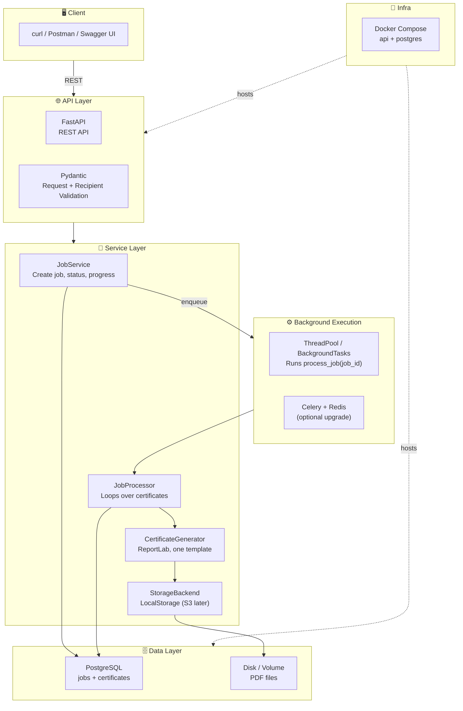
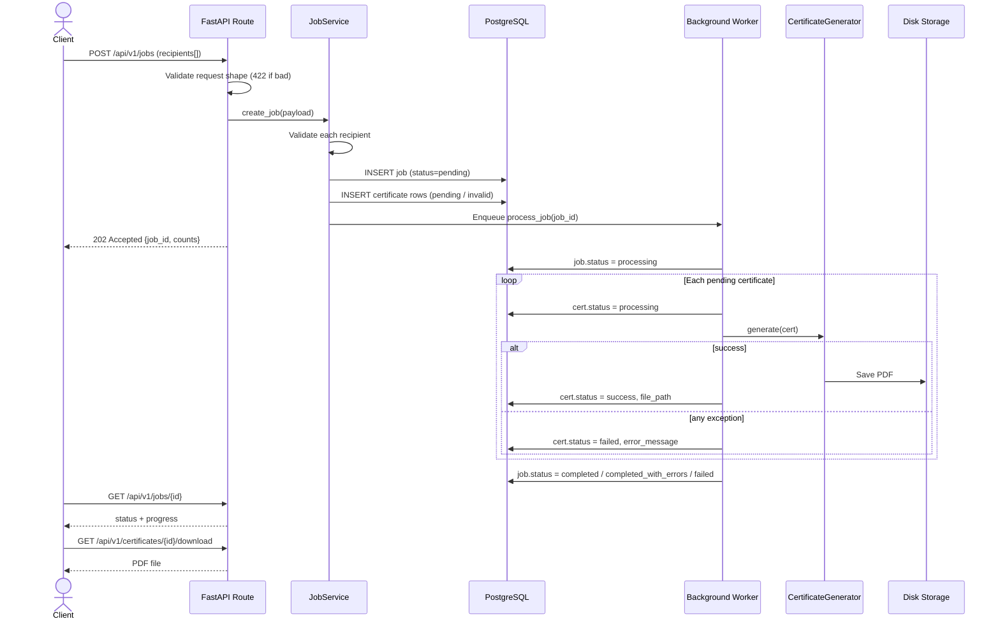
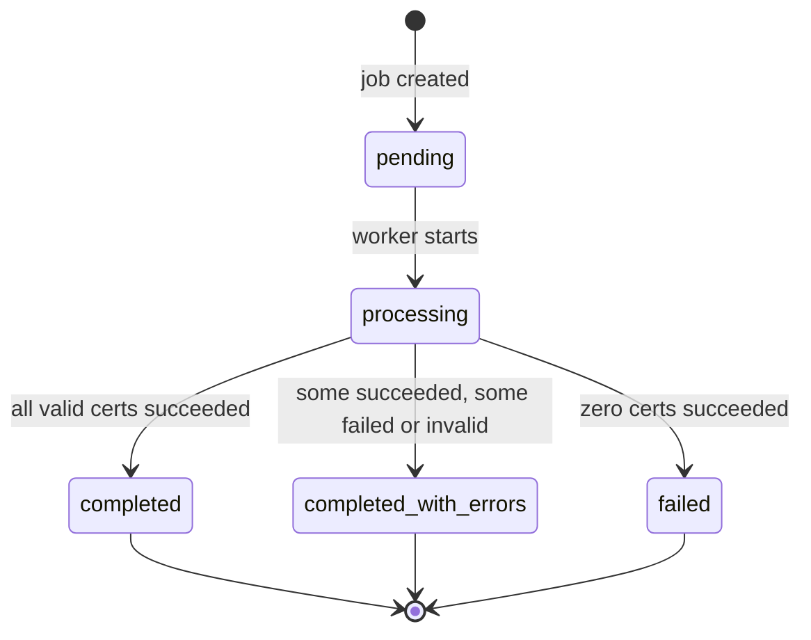
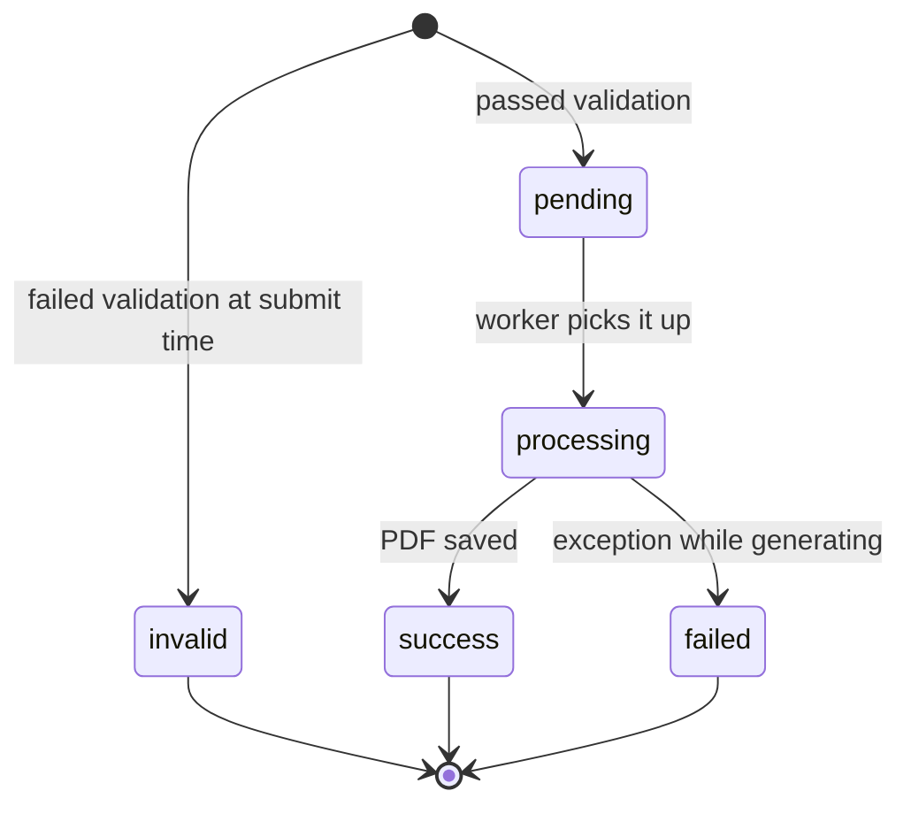

# Bulk Certificate Generator — Design & Architecture

> Backend API. Client sends a list of recipients in one request → system generates a PDF certificate for each from one fixed template → client tracks progress and downloads results.

---

## 1. High-Level Architecture



**Layers, simply:**

- **Routes** only handle HTTP (parse request, return response). No business logic.
- **Services** hold the logic (create job, process job, build status).
- **Generator + Storage** are small classes with one job each, so they are easy to swap or mock in tests.
- **Models** are SQLAlchemy tables. **Schemas** are Pydantic request/response shapes.

---

## 2. Data Flow — Generating 				Certificates



---

## 3. Directory Structure

```
certificate-generator/
├── app/
│   ├── main.py                    # FastAPI app, router include, error handlers
│   ├── config.py                  # Settings (env vars): DB URL, storage dir, limits
│   ├── database.py                # engine, SessionLocal, get_db dependency
│   ├── api/
│   │   ├── deps.py                # get_db, get_storage
│   │   └── routes/
│   │       ├── jobs.py            # POST /jobs, GET /jobs/{id}, list certs, zip
│   │       ├── certificates.py    # GET /certificates/{id}/download
│   │       └── health.py          # GET /health
│   ├── models/
│   │   ├── job.py                 # Job model + JobStatus enum
│   │   └── certificate.py         # Certificate model + CertificateStatus enum
│   ├── schemas/
│   │   ├── job.py                 # JobCreate, JobCreated, JobStatusOut
│   │   └── certificate.py         # RecipientIn, CertificateOut
│   ├── services/
│   │   ├── job_service.py         # create_job, get_job_status
│   │   ├── job_processor.py       # process_job(job_id) — the worker loop
│   │   ├── certificate_generator.py  # CertificateGenerator class (ReportLab)
│   │   └── storage.py             # StorageBackend (abstract) + LocalStorage
│   └── core/
│       ├── exceptions.py          # NotFoundError, GenerationError
│       └── logging.py
├── assets/
│   └── fonts/                     # TTF fonts used by the template
├── alembic/                       # Migrations
├── tests/
│   ├── conftest.py                # test DB, client fixture, tmp storage
│   ├── test_create_job.py
│   ├── test_validation.py
│   ├── test_generator.py
│   ├── test_job_status.py
│   ├── test_failure_handling.py
│   └── test_retrieval.py
├── storage/                       # Generated PDFs (git-ignored)
├── Dockerfile
├── docker-compose.yml
├── requirements.txt
├── .env.example
└── README.md
```

---

## 4. Tech Stack Reference

### Layer 1 — API

| Tech                  | Role                                    | Notes                              |
| --------------------- | --------------------------------------- | ---------------------------------- |
| **FastAPI** ✓  | REST API, auto Swagger docs at`/docs` | Alt: Django REST Framework         |
| **Pydantic v2** | Request/response validation             | Email check via`email-validator` |
| **Uvicorn**     | ASGI server                             |                                    |

### Layer 2 — Data

| Tech                     | Role                                  | Notes                     |
| ------------------------ | ------------------------------------- | ------------------------- |
| **PostgreSQL** ✓  | Relational DB for jobs + certificates | Runs in Docker            |
| **SQLAlchemy 2.0** | ORM                                   | Alt: Django ORM           |
| **Alembic**        | Migrations                            |                           |
| **SQLite**         | DB for tests only                     | Fast, no setup, in-memory |

### Layer 3 — Processing

| Tech                                              | Role                                           | Notes                             |
| ------------------------------------------------- | ---------------------------------------------- | --------------------------------- |
| **ThreadPoolExecutor / BackgroundTasks** ✓ | Run the job after the HTTP response            | Zero extra infra, easy to explain |
| **Celery + Redis**                          | Optional upgrade for real queueing and retries | Alt: RQ, ARQ. See section 8       |

### Layer 4 — Certificate Generation

| Tech                       | Role                                                 | Notes                       |
| -------------------------- | ---------------------------------------------------- | --------------------------- |
| **ReportLab** ✓     | Draw the template and fill recipient data into a PDF | Pure Python, no system deps |
| **Pillow**           | Alt if PNG output is wanted                          |                             |
| **zipfile (stdlib)** | Bundle all certificates into one ZIP                 |                             |

### Layer 5 — Testing & Infra

| Tech                                  | Role                                      | Notes                          |
| ------------------------------------- | ----------------------------------------- | ------------------------------ |
| **pytest + httpx (TestClient)** | API + unit tests                          |                                |
| **Docker + Compose**            | `docker compose up` runs API + Postgres | Job post says Docker is a plus |
| **Redis**                       | Only if Celery upgrade is added           | Job post says Redis is a plus  |

---

## 5. Database Schema (Core Tables)

```sql
-- One row per bulk request
jobs (
  id UUID PK,
  title TEXT,                 -- e.g. "Python Bootcamp 2026"
  issued_by TEXT,             -- organization name printed on certificate
  status TEXT,                -- pending | processing | completed | completed_with_errors | failed
  total_count INT,            -- number of recipients in the request
  created_at, started_at, finished_at
)

-- One row per recipient
certificates (
  id UUID PK,
  job_id UUID FK → jobs.id ON DELETE CASCADE,
  position INT,               -- index in the original request (for error reporting)
  recipient_name TEXT,
  recipient_email TEXT,
  title TEXT,                 -- course title copied for uniqueness check
  certificate_number TEXT UNIQUE,   -- e.g. CERT-2026-8F3A1C
  status TEXT,                -- pending | processing | success | failed | invalid
  issue_date DATE,            -- date printed on certificate
  file_path TEXT NULL,        -- set only on success
  error_message TEXT NULL,    -- set on failed / invalid
  created_at, generated_at
)

-- Indexes
CREATE INDEX ix_certificates_job_status ON certificates (job_id, status);
CREATE UNIQUE INDEX uq_cert_email_title ON certificates (recipient_email, title) WHERE status != 'invalid';
```

**Why counts are not stored on `jobs`:** success / failed / pending counts are computed with one `GROUP BY status` query when the status endpoint is called. Stored counters can drift if a worker crashes between two updates. A query cannot drift.

---

## 6. State Machines

### Job status



### Certificate status



**Final job status rule** (computed once, at the end of `process_job`):

```
if success == 0                 → failed
elif failed + invalid == 0      → completed
else                            → completed_with_errors
```

---

## 7. API Design

Base path: `/api/v1`

| Method | Path                                 | Purpose                               | Success |
| ------ | ------------------------------------ | ------------------------------------- | ------- |
| POST   | `/jobs`                            | Submit bulk request                   | `202` |
| POST   | `/jobs/upload`                     | Submit bulk request via file upload   | `202` |
| GET    | `/jobs/{job_id}`                   | Status + progress + counts            | `200` |
| GET    | `/jobs/{job_id}/certificates`      | List certificates (filter + paginate) | `200` |
| GET    | `/jobs/{job_id}/download`          | ZIP of all successful PDFs            | `200` |
| GET    | `/certificates/{cert_id}/download` | One PDF                               | `200` |
| GET    | `/health`                          | Liveness check                        | `200` |

### POST `/jobs`

Request:

```json
{
  "title": "Python Bootcamp 2026",
  "issued_by": "Acme Academy",
  "recipients": [
    { "name": "Asha Verma", "email": "asha@example.com", "issue_date": "2026-10-01" },
    { "name": "Rohan Das",  "email": "not-an-email",     "issue_date": "2026-10-01" },
    { "name": "",           "email": "empty@example.com", "issue_date": "2026-10-01" }
  ]
}
```

Response `202 Accepted`:

```json
{
  "job_id": "5f1c...",
  "status": "pending",
  "total": 3,
  "accepted": 1,
  "rejected": 2,
  "rejected_items": [
    { "position": 1, "error": "recipient_email: not a valid email address" },
    { "position": 2, "error": "recipient_name: must not be empty" }
  ],
  "status_url": "/api/v1/jobs/5f1c..."
}
```

### GET `/jobs/{job_id}`

```json
{
  "job_id": "5f1c...",
  "title": "Python Bootcamp 2026",
  "status": "completed_with_errors",
  "progress": { "total": 3, "processed": 3, "percent": 100 },
  "counts": { "success": 1, "failed": 0, "invalid": 2, "pending": 0, "processing": 0 },
  "created_at": "...",
  "started_at": "...",
  "finished_at": "...",
  "failures": [
    { "certificate_id": "a1...", "position": 1, "status": "invalid", "error": "recipient_email: not a valid email address" }
  ]
}
```

`processed = success + failed + invalid`. `percent = processed / total * 100`.

### GET `/jobs/{job_id}/certificates`

Query params: `status` (optional filter), `limit` (default 50, max 200), `offset` (default 0).

Each item: `id, position, recipient_name, recipient_email, certificate_number, status, error_message, download_url` (`download_url` only when `status = success`).

### Error responses

| Case                                                               | Code                                          |
| ------------------------------------------------------------------ | --------------------------------------------- |
| Bad request shape (missing`recipients`, wrong types, empty list) | `422` (FastAPI default)                     |
| More than`MAX_RECIPIENTS_PER_JOB` (1000)                         | `413`                                       |
| Job or certificate not found                                       | `404`                                       |
| Download requested but certificate not`success`                  | `409` with message                          |
| Unexpected server error                                            | `500` with generic message, details in logs |

All errors use one shape: `{ "detail": "..." }`.

---

## 8. Processing Design

### Two levels of validation

| Level                     | When                            | What is checked                                                                                              | On failure                                                             |
| ------------------------- | ------------------------------- | ------------------------------------------------------------------------------------------------------------ | ---------------------------------------------------------------------- |
| **Request level**   | Before anything is saved        | `title`, `issued_by`, `issue_date` present; `recipients` is a non-empty list; size ≤ 1000           | Whole request rejected (422 / 413)                                     |
| **Recipient level** | In`create_job`, per recipient | name 1–100 chars after trim; valid email; no duplicate email in the same job; no control characters in name | That recipient saved as`invalid` with a clear error. Others continue |

This matches the brief: one bad recipient must not block the others, and the job status shows exactly which ones failed and why.

### The worker loop

```python
# app/services/job_processor.py
def process_job(job_id: UUID) -> None:
    db = SessionLocal()                      # NEW session — never reuse the request's session
    try:
        job = db.get(Job, job_id)
        job.status = JobStatus.PROCESSING
        job.started_at = utcnow()
        db.commit()

        pending = db.scalars(
            select(Certificate)
            .where(Certificate.job_id == job_id, Certificate.status == CertStatus.PENDING)
            .order_by(Certificate.position)
        ).all()

        for cert in pending:
            try:
                cert.status = CertStatus.PROCESSING
                db.commit()
                path = generator.generate(job, cert)      # may raise
                cert.file_path = path
                cert.status = CertStatus.SUCCESS
                cert.generated_at = utcnow()
            except Exception as exc:                      # isolate EVERY failure
                logger.exception("cert %s failed", cert.id)
                cert.status = CertStatus.FAILED
                cert.error_message = str(exc)[:500]
            finally:
                db.commit()                               # commit per certificate

        job.status = compute_final_status(db, job_id)
        job.finished_at = utcnow()
        db.commit()
    except Exception:
        logger.exception("job %s crashed", job_id)
        db.rollback()
        mark_job_failed(db, job_id)
    finally:
        db.close()
```

Key points to explain in the interview:

- **Commit per certificate**, so progress is visible live and a crash loses at most one item.
- **try/except inside the loop**, so one failure never stops the rest.
- **New DB session in the worker**, because the request session is closed after the response is sent.
- **Only `pending` rows are processed**, which makes the function safe to re-run (a retry just picks up what is left).

### Certificate generator

```python
# app/services/certificate_generator.py
class CertificateGenerator:
    def __init__(self, storage: StorageBackend): ...

    def generate(self, job: Job, cert: Certificate) -> str:
        """Render PDF bytes, hand to storage, return the stored path."""
        pdf_bytes = self._render(job, cert)
        return self.storage.save(f"{job.id}/{cert.id}.pdf", pdf_bytes)

    def _render(self, job, cert) -> bytes:
        # A4 landscape. One fixed template drawn in code:
        #   border → title "Certificate of Completion" → "This is to certify that"
        #   → recipient_name (large) → job.title → issue_date + issued_by
        #   → certificate_number (bottom corner)
        ...
```

Long names are scaled down with a width check (`stringWidth`) so they never overflow the page.

### Storage abstraction

```python
class StorageBackend(ABC):
    @abstractmethod
    def save(self, relative_path: str, data: bytes) -> str: ...
    @abstractmethod
    def read(self, path: str) -> bytes: ...

class LocalStorage(StorageBackend): ...   # writes under STORAGE_DIR
```

Moving to S3 / R2 later means adding one class. No other code changes.

### Why background processing (decision to document in README)

| Option                                          | Pros                                              | Cons                                                           | Verdict                    |
| ----------------------------------------------- | ------------------------------------------------- | -------------------------------------------------------------- | -------------------------- |
| **Synchronous**                           | Simplest                                          | Request times out with thousands of recipients; client blocked | ❌ Does not fit "bulk"     |
| **FastAPI BackgroundTasks / thread pool** | No extra infra, tiny code, easy to explain        | Jobs lost if the process dies mid-run; one process only        | ✅**Chosen for v1**  |
| **Celery + Redis**                        | Survives restarts, retries, scales across workers | More moving parts                                              | 🔼 Documented upgrade path |

`process_job(job_id)` only takes an id and opens its own DB session, so switching to Celery is one decorator plus one `.delay(job_id)` call. The processing code does not change.

**Known limitation to mention honestly:** with the thread approach, if the server restarts while a job is `processing`, that job stays stuck. Mitigation (optional): on app startup, find jobs in `processing` and re-enqueue them. This is safe because only `pending` certificates are picked up.

---

## 9. Key Design Decisions

| Decision              | Choice                                              | Why                                                  |
| --------------------- | --------------------------------------------------- | ---------------------------------------------------- |
| Framework             | FastAPI                                             | Auto docs, Pydantic validation built in, async-ready |
| Processing            | Background thread pool (Celery as upgrade)          | Right size for the task, easy to explain and modify  |
| Response on submit    | `202 Accepted` + `job_id`                       | Honest: work is not done yet                         |
| Per-recipient storage | One DB row per certificate                          | Gives per-item status, error, and file path          |
| Invalid recipients    | Saved as`invalid`, not dropped                    | Client can see exactly what was rejected and why     |
| Failure isolation     | try/except per certificate + commit per certificate | One failure never blocks others                      |
| Progress counts       | Computed with`GROUP BY`                           | Cannot drift out of sync                             |
| Certificate format    | PDF via ReportLab                                   | Printable, no system dependencies                    |
| File storage          | Local disk behind`StorageBackend`                 | Simple now, S3-ready later                           |
| Certificate ID        | `CERT-<year>-<6 hex>` stored with UNIQUE          | Human-readable, collision-safe                       |
| Limits                | Max 1000 recipients per request                     | Protects the server; limit is configurable           |
| Tests DB              | SQLite in-memory                                    | Fast and no setup. Real DB is Postgres               |

---

## 10. Phased Implementation Plan

### Phase 1 — Foundation (Day 1)

**Goal:** Project runs, DB connected

- [ ] Init repo, venv, `requirements.txt`, `.gitignore`, `.env.example`
- [ ] FastAPI skeleton + `GET /health`
- [ ] `config.py` (env vars) and `database.py` (engine, session, `get_db`)
- [ ] SQLAlchemy models: `Job`, `Certificate` + enums
- [ ] Alembic initial migration
- [ ] Docker Compose: API + Postgres

**Deliverable:** `docker compose up` → `/health` returns 200, tables exist.

---

### Phase 2 — Create Job + Validation (Day 2)

**Goal:** Submit a bulk request, get a `job_id`

- [ ] Pydantic schemas: `JobCreate`, `RecipientIn`, `JobCreated`
- [ ] `JobService.create_job` with per-recipient validation
- [ ] `POST /api/v1/jobs` returns 202 with accepted / rejected counts
- [ ] Size limit (413) and duplicate email check
- [ ] Tests: create job, request validation, recipient validation

**Deliverable:** Valid and invalid recipients are stored with the right status.

---

### Phase 3 — Certificate Generation (Day 3)

**Goal:** PDFs are actually produced

- [ ] `CertificateGenerator` with the one fixed template
- [ ] `StorageBackend` + `LocalStorage`
- [ ] Long-name handling, special characters (use a Unicode TTF font)
- [ ] Test: generator returns a valid PDF (starts with `%PDF`, contains name text)

**Deliverable:** Calling `generate()` on a row writes a correct PDF to disk.

---

### Phase 4 — Background Processing (Day 4)

**Goal:** Jobs run by themselves

- [ ] `process_job(job_id)` loop with per-certificate isolation
- [ ] `compute_final_status` rule
- [ ] Hook into `POST /jobs` via background task
- [ ] Tests: full job success, one certificate failing (monkeypatch generator), final status values

**Deliverable:** POST a job → certificates generate in background → statuses update.

---

### Phase 5 — Status + Retrieval (Day 5)

**Goal:** Client can track and download

- [ ] `GET /jobs/{id}` with progress, counts, failures list
- [ ] `GET /jobs/{id}/certificates` with filter + pagination
- [ ] `GET /certificates/{id}/download` (404 / 409 handling)
- [ ] `GET /jobs/{id}/download` (ZIP of successes)
- [ ] Tests: progress values, filtering, download success, download of failed cert → 409

**Deliverable:** Full flow works end to end from curl.

---

### Phase 6 — Polish + Docs (Day 6)

**Goal:** Ready to submit

- [ ] Global error handler (one `{detail}` shape)
- [ ] Logging with job id in each log line
- [ ] README: setup, run, test, submit request, retrieve certificates, design decisions
- [ ] Re-enqueue stuck `processing` jobs on startup (optional)
- [ ] Redis + Celery branch (optional, only if time remains)

**Deliverable:** A fresh clone runs with the README steps only.

---

## 11. Testing Plan

Setup in `conftest.py`: SQLite in-memory DB, `TestClient` with `get_db` overridden, `LocalStorage` pointed at pytest's `tmp_path`, and background processing run **synchronously** in tests so results are deterministic.

| Required area          | Test file                    | Cases                                                                                                                                                                                  |
| ---------------------- | ---------------------------- | -------------------------------------------------------------------------------------------------------------------------------------------------------------------------------------- |
| Creating a job         | `test_create_job.py`       | Valid request → 202 +`job_id`; rows created with correct count; job starts `pending`                                                                                              |
| Input validation       | `test_validation.py`       | Missing field → 422; empty list → 422; over limit → 413; bad email →`invalid`; empty name → `invalid`; duplicate email → `invalid`; mixed valid + invalid keeps valid ones |
| Certificate generation | `test_generator.py`        | PDF bytes start with`%PDF`; file saved at expected path; long name does not crash; unicode name works                                                                                |
| Job status / progress  | `test_job_status.py`       | Counts add up to total; percent correct; final status`completed`, `completed_with_errors`, `failed` each covered; unknown job → 404                                             |
| Individual failure     | `test_failure_handling.py` | Patch generator to raise for one name → that cert`failed` with message, others `success`, job `completed_with_errors`                                                           |
| Retrieval              | `test_retrieval.py`        | Single PDF download; ZIP contains only successes; failed cert → 409; list with`status` filter; pagination                                                                           |

---

## 12. Out of Scope (on purpose)

- Template editor or multiple designs (brief says one fixed template)
- User accounts and login
- Email delivery
- Frontend UI (Swagger at `/docs` is enough for demo)
